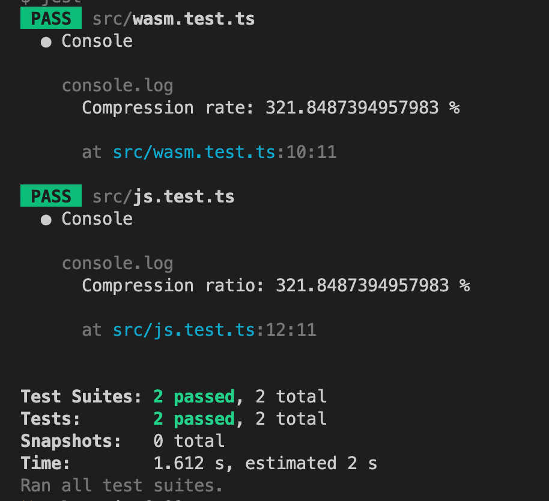

# brotli-compress

[](https://www.npmjs.com/package/brotli-compress)
[](https://www.npmjs.com/package/brotli-compress)
[](https://www.npmjs.com/package/brotli-compress)
[](https://github.com/kyr0/brotli-compress/blob/main/LICENSE)
[](https://socket.dev/npm/package/brotli-compress)
[](https://www.npmjs.com/package/brotli-compress)

This package packages `brotli-wasm-custom-dictionary` (a `brotli-wasm` fork with
custom dictionary support), minifies and inlines it, so that it works consistently
in Node.js and Browser environments. This solves [several issues](https://github.com/rustwasm/wasm-pack/issues/1106) of using `brotli-wasm` directly.

Furthermore, this package comes with two module variants: CommonJS and ESM.
On top of this, this library comes with a copy of the original Brotli `decompress`
implementation by Google, with an optimized API to be 1:1 compatible with
the WASM variant and with TypeScript typing support.

All in all, this package is the Brotli "fire and forget" solution that should
work in all JavaScript environments, with all bundlers and ecosystems, including
Vite, Rollup, Webpack, Gatsby and Next.js projects as well as Node.js.

This library can yield stellar compression ratios at byte-level - e.g. output 68.9% smaller than the input (a 3.22x reduction) in our unit test case:



If you're looking for even crazier compression rates at "character level", take a look at
my novel algorithm, [`brotli-unicode`](https://github.com/kyr0/brotli-unicode), where the raw Brotli output binary is encoded using
a subset of the Unicode BMP-1 alphabet. It leads to character level compression rates of 500%+.

## Setup

As a package for development (Node.js, Browsers):

```bash
  yarn add brotli-compress

  # or

  npm i brotli-compress

  # or

  bun add brotli-compress
```

## Which variant should I use?

The package ships three entry points; all of them work in Node.js and in the
browser, and all support custom dictionaries:

| Import path | Engine | Compress | Decompress | Size (minified) |
|---|---|---|---|---|
| `brotli-compress` | WASM | one-shot + streaming | one-shot + streaming | ~1.8 MB (wasm inlined) |
| `brotli-compress/external` | WASM | one-shot + streaming | one-shot + streaming | ~13 KB + separate 1 MB `.wasm` asset |
| `brotli-compress/js` | pure JS | — | one-shot only, synchronous | ~152 KB |

- Use `brotli-compress` for maximum performance with zero configuration — the
  WASM binary is base64-inlined, so it just works everywhere (CJS + ESM).
- Use `brotli-compress/external` when bundle size matters (e.g. to avoid
  "module too large" bundler warnings) — the `.wasm` file is emitted as a
  separate asset by your bundler (ESM only).
- Use `brotli-compress/js` when you only need decompression and want the
  smallest possible download.

Both, CommonJS and ESM module formats, are provided (except where noted).

## Usage of the WASM variant

The usage in a Node.js or Browser environment is trivial:

```ts
// import size (uncompressed, but minified) / WASM version / max performance: 1.8M
import { compress, decompress } from 'brotli-compress'

const textEncoder = new TextEncoder();
const oneBlockInput = 'Hello🤖!'

// it takes a Uint8Array and returns a Uint8Array
const compressed = await compress(textEncoder.encode(oneBlockInput))

// it takes a Uint8Array and returns a Uint8Array
const decompressed = await decompress(compressed)
const decompressedString = new TextDecoder().decode(decompressed)
```

Please note that the WASM version comes with a whopping size of (minified)
1.8MiB. This is, because the binary is base64 encoded and inlined.

If you prefer maximum performance and memory efficiency over small bundle size,
choose the WASM variant. Also, if you need compression, use the WASM version.

### External WASM variant (small JS bundle)

If the inlined 1.8MiB payload is a problem (e.g. "module too large" bundler
warnings), use the external variant instead. It is the same WASM build with the
same API, but the `.wasm` binary is referenced as a separate file instead of
being inlined — bundlers like Vite/Rollup emit it as a regular asset:

```ts
// import size (uncompressed, but minified): ~13K + separate 1MiB .wasm asset
import { compress, decompress } from 'brotli-compress/external'
```

This variant is ESM-only (there is no CommonJS build of it). With a bundler
(Vite, Rollup, webpack), just use the import above — the `.wasm` file is
emitted as a separate asset automatically. It also works directly in plain
Node.js ESM (the `.wasm` file is read from disk):

```js
// example.mjs
import { compress, decompress } from 'brotli-compress/external'

const compressed = await compress(new TextEncoder().encode('Hello🤖!'))
const decompressed = new TextDecoder().decode(await decompress(compressed))
console.log(decompressed) // Hello🤖!
```

```sh
node example.mjs
```

If you host the `.wasm` file yourself (e.g. on a CDN), you can point any
variant at it with the `wasmFileUrl` option:

```ts
const compressed = await compress(input, { wasmFileUrl: 'https://example.com/brotli_wasm_bg.wasm' })
```

## Usage of the pure JS variant

If you need a small bundle size, can afford the slowdown and
only need decompression, use the handwritten JavaScript decompressor:

```ts
// import size (uncompressed, but minified) / JS version / only decompress / slower: 152K
import { decompress } from 'brotli-compress/js'

// please also note that the pure JS variant is synchronous
// for large inputs, you could optimize the execution by moving
// this call into a Worker

// it takes a Uint8Array and returns a Uint8Array
const decompressed = decompress(compressed)
```

## Encoding to Uint8Array and decoding from Uint8Array

For Node.js, you'd be well advised to use the built-in `Buffer` package:

```ts
import { Buffer } from 'buffer'

const testInput = 'Hello🤖!'
const testInputUint8 = Buffer.from(testInput)
const compressed = await compress(testInputUint8)
const decompressed = await decompress(compressed)
const decompressedString = Buffer.from(decompressed).toString()
```

For use in browser/frontend, you can either use `TextEncoder` and `TextDecoder`
or use a polyfill like the [buffer](https://www.npmjs.com/package/buffer) library.

```ts
new TextEncoder().encode(testInput) // returns a Uint8Array
new TextDecoder().decode(compressed) // returns a string from the compressed Uint8Array
```

## Options

The `compress` method comes with a second `options` parameter.

### Quality level

The most common setting is `quality` with a scale from 0 to 11.
By default, the quality is set to best quality (11).

```ts
const compressed = await compress(Buffer.from('foobar'), { quality: 9 })
```

A lower quality value makes the output bigger but improves compression time.
Quality 11 gives the best ratio but is by far the slowest option; for large or
latency-sensitive payloads, a value in the 5–9 range is usually a better
trade-off.

### Custom dictionary

Both, `compress()` and `decompress()` support a custom dictionary via the
`customDictionary` option (a `Uint8Array` of tokens that are `a priori` known to
appear in the input). This can dramatically shrink the output for small, similar
payloads — e.g. if you know that you'll be compressing TypeScript source code, you
could include the keywords of the TypeScript language in the custom dictionary:

```ts
const customDictionary = new Uint8Array(fs.readFileSync('dictionary.bin'))
const compressed = await compress(input, { quality: 11, customDictionary })
const decompressed = await decompress(compressed, { customDictionary })
```

This uses raw (LZ77) dictionary semantics, exactly like the reference C encoder's
`BrotliEncoderAttachPreparedDictionary(..., BROTLI_SHARED_DICTIONARY_RAW, ...)`,
i.e. the `brotli` CLI's `-D FILE` flag. The dictionary is **not** embedded in the
compressed stream; the decoder must attach the identical dictionary, and
decompression fails loudly without it. Data compressed by the reference CLI with
`-D` can be decompressed here, and vice versa — note that the usable dictionary
size is limited by the window size (at most `2^lgwin - 16` bytes; this package
encodes with the default window, so dictionaries up to ~4 MiB are fully usable).

Custom dictionary support is provided by
[`brotli-wasm-custom-dictionary`](https://github.com/kyr0/brotli-wasm), a fork of
`brotli-wasm` with dictionary support for compression and decompression.
The external WASM variant (`brotli-compress/external`) exposes the exact same
dictionary-capable API; only the way the `.wasm` binary is loaded differs.

Additionally, a handwritten pure-JS decoder is exposed as a separate entry point
(it supports custom dictionaries for decompression as well):

```ts
import { decompress } from 'brotli-compress/js'

const decompressed = decompress(compressed, { customDictionary }) // synchronous
```

## Streaming

Streaming compression and decompression are available via `createCompressStream`
and `createDecompressStream`. Both accept the same options as their one-shot
counterparts (`quality`, `customDictionary`).

Feed input in chunks; each call returns `{ code, buf, input_offset }`. When the
output buffer is too small, `code` is `NeedsMoreOutput` and `input_offset` tells
you how much of the chunk was consumed — re-feed the rest. Finalize compression
by calling `compress(null, outputSize)` until `ResultSuccess`:

```ts
import { createCompressStream, createDecompressStream, BrotliStreamResultCode } from 'brotli-compress'

const stream = await createCompressStream({ quality: 11 })
const chunks = []

for (const inputChunk of inputChunks) {
  let offset = 0
  while (offset < inputChunk.byteLength) {
    const res = stream.compress(inputChunk.subarray(offset), 16384)
    chunks.push(res.buf)
    offset += res.code === BrotliStreamResultCode.NeedsMoreOutput
      ? res.input_offset
      : inputChunk.byteLength
  }
}

for (;;) {
  const res = stream.compress(null, 16384) // finish
  chunks.push(res.buf)
  if (res.code === BrotliStreamResultCode.ResultSuccess) break
}
stream.free()
```

Decompression works the same way: feed compressed chunks via
`stream.decompress(chunk, outputSize)` until `ResultSuccess`. The streams are
synchronous; the `create*Stream` factories are only async because the WASM
module has to be initialized once.

## Build

    npm run build    # or: bun build

## Test

    npm test         # or: bun test

## Release parity gate

To keep the [SECURITY.md](SECURITY.md) promise ("nothing is ever removed or
behaviour changed"), every publish is gated. `npm run gate`
([`scripts/release-gate/`](scripts/release-gate/release-gate.ts)):

1. packs the upcoming release (`npm pack` — the same build that publish produces),
2. downloads the latest published tarball from npm,
3. compares the full published artifact set — flagging any removed import file,
   `exports` subpath, ESM/CJS condition, or exported symbol, and
4. re-runs the test suite against **both** installed tarballs and asserts
   **byte-for-byte identical output** for every compress/decompress configuration
   encoded in the tests (across `.`, `/js` and `/external`, in both ESM and CJS).

Everything runs under `tmp/release-gate/` (gitignored); the human-readable report
is written to `tmp/release-gate/gate-report.md`. `npm publish` is gated via the
`prepublishOnly` hook, so an accidental behaviour change or removed export blocks
the release.

Publishing an **intentional** behaviour change (e.g. a correctness fix): bump the
version, record it under "Documented behaviour changes" in SECURITY.md, then
publish once with `npm run release` (which builds and bypasses the gate for this
one acknowledged change). The gate then re-baselines against the newly published
version and goes green again for subsequent releases.

### Stability corpus & version sweep

Three extras back the promise above:

- A golden `.br` corpus in `src/__test__/fixtures/` (generated via
  `npm run fixtures:generate`) pins compress + WASM/JS decompress output for ~40
  configurations. `npm test` fails if any byte drifts — e.g. after bumping the
  upstream WASM package.
- `npm run test:fuzz` re-runs a custom-dictionary encoder fuzzing across **every quality 0-11**, each in a fresh process, so the upstream can never silently regress.
- `npm run test:e2e` installs **every released version** on npm, compresses a string with it, and asserts the current build decodes the result - proving the current decoder stays backward compatible with all historical releases.

## Licensing

Most of the code of this library is licensed under Apache-2.0 (see [LICENSE](LICENSE)).
The pure-JS `decompress` implementation (`src/js.ts`, also shipped minified as
`js.mjs`/`js.cjs`) is derived from Google's Brotli decoder and is licensed by
Google under the MIT license (see [LICENSE-MIT](LICENSE-MIT)); the copyright
notice is preserved in the minified artifacts.

## Contributors

Package and build configuration plus cross-library implementation, documentation and
unit testing, as well as updating the WASM/JS binding has been done by Aron Homberg.

`brotli-wasm` that ships with this package inline was implemented by [Tim Perry](https://github.com/httptoolkit/brotli-wasm) and contributors.

Direct binding WASM/JS and the respective code extraction idea has been implemented by [stefnotch](https://github.com/stefnotch/url-catpressor/blob/main/src/useCompression.ts)
